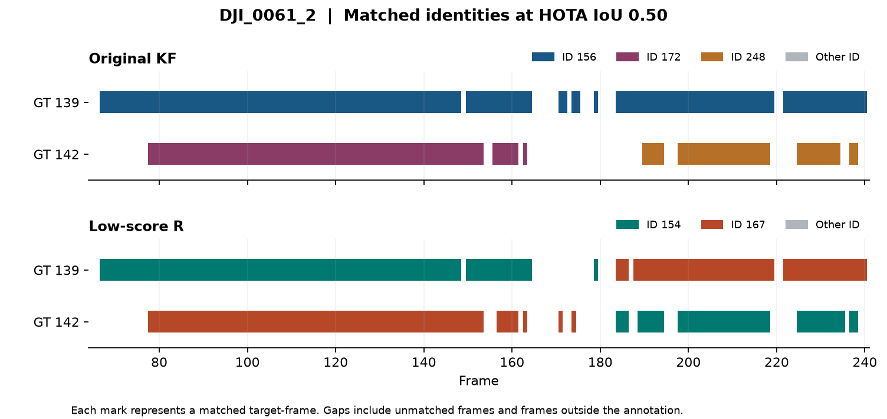

# DJI_0061_2 的保号与关联误差

原始 KF 和仅低分 R 共用检测、观测质量、模型参数、配置与视频输入。两条取证回放的轨迹均与前次正式结果逐字节一致。所有目标和帧号均按官方可见光真值；身份延续在各自回放内部判定，跨方法对齐依靠真值目标、帧和冻结检测行。

## 分段与剔除该段后的独立评测

| 范围 | 方法 | HOTA | DetA | AssA | IDF1 | MOTA | FP | FN | IDSW |
|---|---|---:|---:|---:|---:|---:|---:|---:|---:|
| DJI_0061_2 · 240 帧 | 原始 KF | 31.6285 | 24.0106 | 42.5861 | 37.1257 | 23.5476 | 1,871 | 17,526 | 158 |
| DJI_0061_2 · 240 帧 | 仅低分 R | 31.3992 | 24.0274 | 41.9593 | 37.2013 | 23.9659 | 1,821 | 17,489 | 138 |
| 其余 29 段 · 12,350 帧 | 原始 KF | 38.7700 | 25.3840 | 60.6179 | 43.3187 | 26.1262 | 11,526 | 102,119 | 264 |
| 其余 29 段 · 12,350 帧 | 仅低分 R | 38.7573 | 25.3513 | 60.6640 | 43.3808 | 26.1411 | 11,479 | 102,144 | 263 |
| 完整 30 段 · 12,590 帧 | 原始 KF | 37.8608 | 25.1865 | 58.3658 | 42.4507 | 25.7593 | 13,397 | 119,645 | 422 |
| 完整 30 段 · 12,590 帧 | 仅低分 R | 37.8222 | 25.1610 | 58.3169 | 42.5147 | 25.8316 | 13,300 | 119,633 | 401 |

每个范围都先用冻结版 TrackEval 对相应序列计算，再调用每项指标自己的跨序列合并函数。30 段、单段以及每段结果均与先前档案核对。

## 换号逐项核销

CLEAR 对每个真值比较当前匹配与上一次可匹配到的轨迹 ID，允许中间有漏检。原始 KF 有 158 次换号，低分 R 有 138 次；108 次发生在同一真值同一帧。下面只列两组各自独有的变化。

| 对照方法在原方法换号处的表现 | 原始 KF 独有 50 次 | 低分 R 独有 30 次 |
|---|---:|---:|
| 前后两端保持同一 ID，区间内无换号 | 24 | 13 |
| 当前真值未匹配 | 19 | 5 |
| 上个参照帧未匹配，当前已匹配 | 5 | 3 |
| 两端均命中，区间中已有身份变化 | 2 | 9 |

在 24 次端点保号中，23 次连两端使用的检测行也完全相同。在后续连续 10 帧有真值的 17 次中，7 次全程以同一 ID 命中。另按同真值、前后 5 帧内的一对一最近换号复核，得到 14 对时间邻近事件，其中 12 对可在同一检测行界定的前后锚点内验证两组各发生一次身份变化。该复核和上表有重叠。

真值 10 在原始 KF 中经历 4 次换号，低分 R 为 0。第 102、149、166 帧低分 R 均保有 ID 11；第 198 帧该方法漏检，不能计作成功保号。

## 逐帧机制与定点撤销

真值 31 的第 104 帧，两组使用同一低分检测，得分 0.436，检测中心与真值相距 2.60 px。在低分 R 当时的同一先验下，原始更新后误差为 2.30 px，学习 R 为 1.69 px。第 105 帧 ID 63 选择冻结检测行 71 或 49；对应行 71 的代价在原始 KF 中为 0.446，在低分 R 中为 0.521，越过门限 0.5。第 109 帧真值由原始 KF 的 ID 169 接手，低分 R 仍为 63。

真值 82 在第 208 帧之后有一段观测间断。第 223 帧，两组对同一高分候选的代价分别为 0.847 与 0.686，门限 0.8。第 228 帧原始 KF 从 ID 255 改由 272 匹配，低分 R 仍沿用自己的 ID 240。

为区分单次更新与更长的历史，以下在低分 R 回放中只将指定轨迹的一次或连续数次低分更新恢复成原生 KF。其余输入和跟踪参数一致，首次干预之前的输出逐字节一致。选取的均为这段测试视频上事后核查的事件。

| 真值 | 实际撤销帧 | 核查帧 | 原 KF 的 ID | 低分 R 的 ID | 撤销后 ID | 是否沿用原低分 R 的旧 ID |
|---:|---|---:|---:|---:|---:|---|
| 31 | 104 | 109 | 169 | 63 | 63 | 是 |
| 31 | 102,103,104 | 109 | 169 | 63 | 63 | 是 |
| 82 | 205,206,207,208 | 228 | 272 | 240 | 258 | 否 |
| 101 | 108 | 119 | 198 | 120 | 120 | 是 |

## 为什么 HOTA 下降

HOTA 在 19 个 IoU 阈值上分别综合检测准确度和整条轨迹的关联准确度。该段 DetA 变化 +0.0168、AssA 变化 −0.6267 个百分点。逐阈值分别替换 DetA 和 AssA，并平均两种替换顺序，检测项对 HOTA 的贡献为 +0.0165、关联项为 −0.2459，合计 −0.2294 个百分点。

真值 139 的 AssA 贡献下降最大。以 IoU 0.50 为例，原始 KF 的 ID 156 对应真值 139 达 157 帧。低分 R 的 ID 154 与 167 分别对应它 98、54 帧，还分别对应相邻真值 142 共 43、84 帧。这些帧共同降低了同一真值与单一轨迹的长期对应程度。下图使用 HOTA 本身的逐帧匹配，空白表示该阈值下未对应或真值尚未出现。

## 结论

完整 30 段净少的 21 次换号中，20 次来自本段；剔除后 29 段净少 1 次。全量 FN 净减 12，其中该段净减 37，其余序列合计反增 25。FP 改善在本段和其余序列分别为 50 与 47；其余 29 段的 IDF1 仍从 43.3187 提高到 43.3808。该段主导了换号与净漏检收益，不能由换号计数推断 HOTA 或每一段的身份改善。

[逐换号清单](switch_ledger.csv) · [实际关联与 KF 更新](decision_chains.json) · [29 段汇总](pool_metrics.csv) · [各真值的 AssA 分解](gt_association_contributions.csv)
