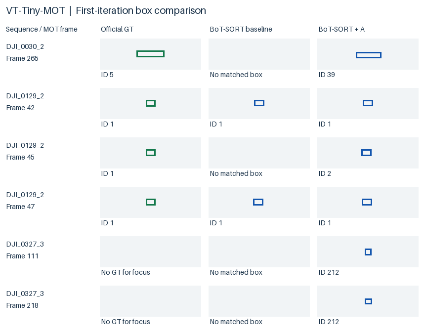

# VT-Tiny-MOT 模块 A 的实现与错因诊断

**A 确实提前找到了目标。性能下降集中在给弱候选分配公开 ID 的环节。** 持续的低分误检可以通过当前证据门，重新出现的真目标也可以在旧 ID 仍处于丢失状态时拿到新 ID。两种情况都会延续到后面的原生关联。沿用原生待确认状态的对照实验大幅减少了误报和换号，也牺牲了部分真实的低分补跟能力。

## 同一份真值上的收益与代价

实验覆盖官方 RGB 测试集的 30 个序列、12,590 帧、870 个真实身份，共 179,772 个有标注的目标帧。所有组复用同一份第 36 轮 YOLO11-M 可见光–红外检测缓存、微调后的 RGB ReID 缓存和原始 RGB 图像，沿用 SOF 相机运动补偿及七类合并评测。统计按 TrackEval 的 COMBINED_SEQ 汇总。逐帧事件采用与 CLEAR 一致的一对一匹配，IoU 门限为 0.50，每个序列都与官方评测器输出的 FP、FN 和 IDSW 核对。HOTA、DetA 和 AssA 使用 TrackEval 原生的多阈值定义。

| 方法 | HOTA ↑ | DetA ↑ | AssA ↑ | IDF1 ↑ | MOTA ↑ | FP ↓ | FN ↓ | IDSW ↓ |
|---|---:|---:|---:|---:|---:|---:|---:|---:|
| BoT-SORT 基线 | 37.86 | 25.19 | 58.37 | 42.45 | 25.76 | 13,397 | 119,645 | 422 |
| 基线 + A | 36.81 | 26.97 | 52.29 | 39.78 | 22.25 | 25,644 | 112,581 | 1,549 |
| A 相对基线 | −1.05 | +1.78 | −6.07 | −2.67 | −3.51 | +12,247 | −7,064 | +1,127 |

两组同时命中 60,044 个 GT 目标帧。只有 A 命中 7,147 个，其中 7,106 个来自弱起轨 ID。只有基线命中 83 个，两组均漏掉 112,498 个。A 额外覆盖了基线全程未命中的 102 个真实身份，保留了基线已覆盖的 509 个。共同覆盖的身份中，171 个更早被 A 命中，1 个更晚。30 段中有 9 段 HOTA 上升、20 段下降、1 段持平。

## 三段可以逐帧核实的例子

| 序列与目标 | 真值、基线和 A 的同帧差异 | 归因 |
|---|---|---|
| DJI_0030_2，GT #5 | 第 265 帧，检测分数 0.197，与 GT 的 IoU 为 0.623。基线漏跟，A 用 #39 连续匹配第 265–345 帧。全段该 GT 的命中从 57/472 增至 232/472。 | 连续弱框提供了可靠的目标证据。同一 GT 后续也出现碎片，全段基线使用 1 个 ID，A 使用 10 个。 |
| DJI_0129_2，GT #1 | 第 42 帧两组都用 #1。第 45 帧 A 新建 #2，此时旧 #1 仍在 lost 池，新旧预测框 IoU 为 0.704。第 46 帧基线恢复 #1，A 仍用 #2，第 47 帧 A 又用回 #1。 | 一个短缺口给 A 带来一次提前补中和两次换号。全段只有这一个标注目标，命中从 540 增到 549，IDSW 从 0 增到 6，HOTA 下降 20.56 点。 |
| DJI_0327_3，A #212 | 第 109–111 帧支撑候选的检测分数为 0.109、0.168、0.119，第三帧证据值为 1.268。A 在第 111–218 帧连续输出 108 帧。逐帧查对，其框与任何 GT、任何基线输出的最大 IoU 均为 0。 | 低分且位置稳定的检测能产生一个持续的新增误报。误报以官方标注为参照。 |

图按归档像素坐标绘制。真目标行展示该 GT 及其 CLEAR 匹配框。误报行以 A #212 为参照。原图路径、原始框的像素坐标和裁剪窗口保存在 [图像案例清单](analysis/image_cases.json)。

## 弱起轨的证据门容易接受稳定误检

`botsort_plus/candidates.py` 第 130、175、235、266 行分别负责确认条件、单次加分、逐帧衰减和命中累积。默认要求最近 5 帧至少命中 3 次，累计证据达到 1.2。每次加分中，归一化检测分数和几何项各占一半。几何代价为 0、检测分数贴近 0.10 时，三次连续命中仅靠几何部分就能贡献 `0.5 × (1 + 0.8 + 0.8²) = 1.22`。这个极限情况解释了低分但位置稳定的检测为何能过门。

- 3,393 次弱起轨中，1,869 次在确认窗口内没有任何一次原检测框达到与任一 GT 的 IoU 0.50。窗口内每次观测都能对齐到同一 GT 的有 939 次，其余 585 次只得到部分支持。未对齐也可能来自小目标框定位不准。
- 936 个弱 ID 的全部实际输出与任何 GT 的 IoU 始终小于 0.10，共贡献 8,306 个 FP 目标帧。其中 903 个 ID 的确认窗口内，所有原始检测框也都低于 0.10。按全部弱 ID 的 FP 目标帧统计，9,969 帧的输出框低于 0.10，其中 9,948 帧所用的原始检测框同样低于 0.10。大量偏差在检测输入上已经可见。
- 至少匹中过 GT 的弱 ID 与始终远离 GT 的弱 ID，其确认时证据中位数分别为 1.541 和 1.402，四分位区间分别为 1.376–1.749 和 1.294–1.547。后者有 620/936 个在连续三帧命中后就完成确认。提高同一个总分门限会同时影响两类轨迹。
- 把两组 FP 按各自在当帧与任意 GT 的最大 IoU 分桶，A 的净变化依次为 **+7,155**（低于 0.10）、**+1,620**（0.10–0.30）、**+3,672**（0.30–0.50）、**−200**（至少 0.50）。远离标注的误报和靠近目标但定位不足的框都在增加，同帧与 GT 高度重叠的未匹配框总体减少。

## 新 ID 与旧 ID 在短缺口后发生竞争

`botsort_plus/native_adapter.py` 第 226–245 行的原生低分关联只续接仍处于 Tracked 状态的轨迹。第 249–257 行传给候选池的占位框来自当帧激活或找回的轨迹。A 单独启用时，丢失轨迹进入原生第一轮高分关联。剩余弱候选达到门限后，第 292–304 行按最新检测新建 STrack，直接设置 `is_activated=True`。这一行为与补丁设计文档第 2.2 节一致。其代价是旧 ID 即便还可用，弱候选也能直接得到另一个 ID。

- A 的 1,549 次 IDSW 中，1,146 次是弱 ID 换成另一个弱 ID，171 次是原生 ID 换成弱 ID，103 次是弱 ID 换回原生 ID，129 次发生在两个原生 ID 之间。这里按 ID 的出生方式分类。两份轨迹在同一 GT、同一帧均换号的有 263 次，仅 A 换号 1,286 次，仅基线换号 159 次。
- **840 次换号正发生在弱 ID 出生当帧。逐事件检查原生 lost 池，671 次仍能找到这个 GT 上一次匹配的旧 ID。** 其中 276 次，新框与旧轨迹当帧预测框的 IoU 达到 0.50，另 395 次低于 0.50。旧 ID 在池中表明存在延续身份的机会，能否在线可靠接回，还取决于与其他候选的竞争及运动、外观证据。
- A 在基线全程没有覆盖的真实身份上产生了 201 次换号。另有 134 次换号的前后两个匹配端点，基线都使用同一个 ID。前者反映新增覆盖的轨迹也会碎片化，后者给出了基线确实能维持身份的实例。全体 870 个 GT 中，300 个的换号次数增加，4 个减少，566 个相同。
- 原生 `botsort.py` 第 417 行在输出前调用 `botsort_utils.py` 第 53–79 行做 active/lost 去重。新旧预测框 IoU 大于 0.85 时按轨龄决定保留哪条。实测 **463 次已记录的弱起轨当帧都在这里被移除，后续始终无输出**。其中 165 次在确认窗口的每个观测都能对齐同一 GT。因此 `weak_birth` 计数包含最终未公开的 ID，评估时应另外记录通过去重和实际输出的数量。

## 用相同缓存改变单个环节

| 全量回放条件 | HOTA ↑ | AssA ↑ | IDF1 ↑ | FP ↓ | FN ↓ | IDSW ↓ |
|---|---:|---:|---:|---:|---:|---:|
| 原始基线 | 37.861 | 58.366 | 42.451 | 13,397 | 119,645 | 422 |
| 原始 A，增加诊断记录 | 36.809 | 52.292 | 39.785 | 25,644 | 112,581 | 1,549 |
| A 适配层运行，候选池返回空 | 37.864 | 58.373 | 42.450 | 13,389 | 119,645 | 422 |
| A 候选池运行，禁止晋升 | 37.889 | 58.342 | 42.480 | 13,025 | 119,639 | 420 |
| A 只保留 3/5 命中门，去掉证据门 | 36.752 | 52.079 | 39.572 | 26,781 | 112,185 | 1,726 |
| A 弱起轨进入原生待确认状态 | 37.971 | 57.613 | 42.437 | 15,518 | 118,110 | 473 |
| A 仅继承候选中心速度 | 36.794 | 52.054 | 39.688 | 25,649 | 112,293 | 1,493 |

**直接确认的影响最大。** 把刚起轨的对象放入原生 unconfirmed 状态，要求后续高分检测再次确认，相对当前 A 减少 10,126 个 FP、1,076 次 IDSW，增加 5,529 个 FN。相对基线仍少 1,535 个 FN，但多 2,121 个 FP、51 次 IDSW。后续关联也随状态而变化。这个控制组产生了 6,711 次弱起轨尝试，包含候选重新积累后的再次尝试，不能按单帧删框理解。

**证据门有一定的过滤作用。** 仅保留 3/5 命中时，弱起轨从 3,393 增至 4,185，FP 再增 1,137，IDSW 再增 177，FN 减少 396。现有分数能拦截一部分事件，对持续低分误检和旧 ID 竞争的区分仍然有限。

**速度交接的影响较小。** 观测原始 A 的 3,393 次弱起轨，Kalman 初始速度全部为零。仅将候选在相机运动补偿坐标中估计的中心速度写入原生 XYWH 滤波器，IDSW 从 1,549 降至 1,493，HOTA 从 36.809 变为 36.794。此项对照只验证当前中心速度估计的交接。另有 1,242 次弱起轨缺少达到更新质量门限的原生 RGB 外观特征，本次没有单独估计其因果影响。

**适配层的一个小差异也已定位。** 候选池返回空时，28/30 段输出与原始基线逐字节一致，其余两段为 `DJI_0061_2`、`DJI_0073_3`。适配层第 211 行显式筛选 Lost，原生第一轮读取整个 lost 列表，其中可能暂留刚标为 Removed 的对象。只在这两段恢复原生的列表枚举，两份输出均逐字节重现基线。该差异全量合计少 8 个 FP，FN 和 IDSW 与基线相同。候选池实际运行但禁止晋升时仍有 261 次原生起轨遭抑制，所以这个对照与空池也有区别。

## 对下一版 A 的含义

1. **先决定旧 ID 能否延续，再决定新建 ID。** 在弱候选晋升处分开记录“匹配旧轨”“暂缓”和“新建”。优先检查本次 671 个旧 ID 仍在池中的事件，并同步统计接错其他 GT 的次数。395 个旧轨预测重叠低于 0.50 的实例说明，仅扩大一个 IoU 门限难以兼顾漏接和错接。
2. **把候选积累与公开输出分开。** 连续弱框可以维持候选，公开新 ID 时再要求更强或互补的证据。以“原生待确认”作为已有的强确认对照，同时监测基线独漏的 7,147 个目标帧、持续远离 GT 的 936 个 ID，以及换号数，衡量新的确认规则保留了多少弱目标收益。

这些判断来自官方测试集上的开发诊断。该测试集曾参与检测与 ReID 选模及门限校准。上述回放用于定位机制，独立数据上的泛化效果仍待验证。所有实验均使用服务器上已接入的补丁提交 `3698607beb10898c00484adc8c1dcb67dd180794`。诊断改动局限在单个回放进程，原始轨迹与模型权重保留在原实验目录。

## 复核文件

- [官方 GT 来源](https://github.com/xuqingyu26/HGTMT)、[原始基线轨迹](../full30/trackers/baseline/data) 和 [原始 A 轨迹](../full30/trackers/A/data) 按相同序列名一一对应。输入版本和逐文件指纹见 [原始评测审计](../full30/metrics/evaluation_audit.json)。加入记录的 A 在 30 段上的轨迹文件均逐字节重现原始 A。
- 实现对应 [候选证据与确认](source_snapshot/botsort_plus/candidates.py)、[原生关联与 A 的交接](source_snapshot/botsort_plus/native_adapter.py) 和 [原生 active/lost 去重](source_snapshot/boxmot/botsort_utils.py)。
- 每条真轨迹、每次弱起轨及每次换号的记录见 [870 条 GT](analysis/gt_tracks.csv)、[3,393 次弱起轨](analysis/promotions.csv) 和 [1,549 次 A 换号](analysis/switches.csv)。
- 联合指标与逐序列对照见 [控制组全量指标](analysis/metrics_with_controls.csv)、[30 段配对结果](analysis/paired_sequences.csv) 和 [案例逐帧数据](analysis/case_frames.csv)。
- 输入指纹、轨迹 SHA-256、针对两段差异的验证及长时误报的逐框核查见 [一致性核验](analysis/verification.json)。各组轨迹、事件、协议与 TrackEval 原始详情均在 `controls/`，两段定点复核在 `subset_check/`。
