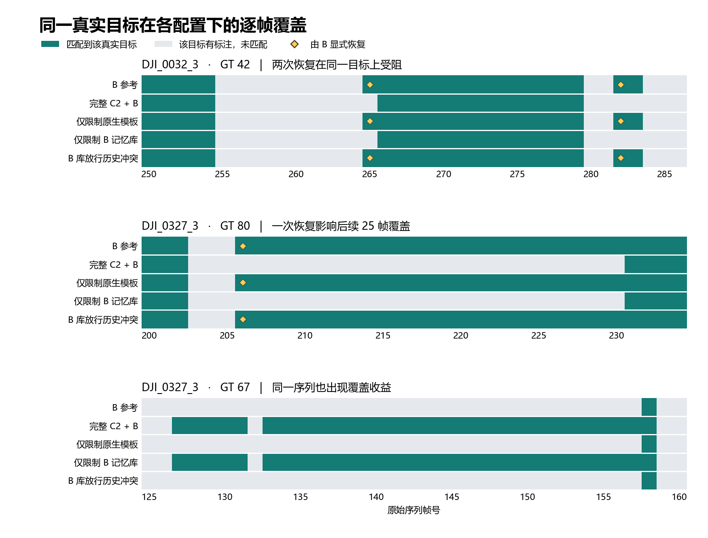

# VT-Tiny-MOT 上 C2 的作用与失效原因

完整 C2 加到 B 上以后，确实挡住了一部分错误恢复，也保住了一些旧 ID。但相对 `B_ref`，HOTA 从 38.727 降到 38.504，IDF1 从 43.862 降到 43.494。**关联代价校准很少改变实际分配。影响更大的是写记忆的规则，尤其是 B 用来重新找回目标的外观记忆库。** 高分观测连续匹配到正确目标时，这个库也会因观测与旧模板相差太大而停止更新，进而在轨迹中断后把同一目标判成外观矛盾。分开控制两个记忆写入位置、再单独放行一种拒绝原因，都重现了这条路径。

## 1. 同一检测缓存上的全量对照

在官方 30 个测试序列、12,590 帧上复用原 YOLO11-M 可见光–红外融合检测、微调 RGB ReID、SOF 运动补偿和跟踪阈值，沿用七类合并评测。表内 HOTA、AssA、IDF1 按百分制计，变化按百分点解读。B 恢复次数统计显式重连事件。FP、FN 是逐帧目标实例数。

| 配置 | HOTA | AssA | IDF1 | FP | FN | IDSW | B 恢复 |
|---|---:|---:|---:|---:|---:|---:|---:|
| B 参考 `B_ref` | 38.727 | 59.203 | 43.862 | 15,753 | 117,482 | 381 | 840 |
| B + 仅 C2 关联校准 | 38.731 | 59.216 | 43.866 | 15,748 | 117,486 | 380 | 838 |
| B + 仅 C2 记忆门控 | 38.494 | 58.988 | 43.484 | 15,281 | 118,023 | 373 | 660 |
| B + 完整 C2 | 38.504 | 59.017 | 43.494 | 15,281 | 118,023 | 372 | 660 |

记忆门控和完整 C2 在 30 段中匹配到的「序列、帧、真实目标」集合完全相同。完整 C2 相对 B 参考少了 472 个 FP、9 次换号，又多了 541 个 FN，DetA 下降 0.226，AssA 下降 0.187。30 段里 HOTA 有 6 段提高、9 段下降、15 段持平。移除 B 后，单加 C2 相对原生基线的 HOTA 也从 37.861 降到 37.815，换号从 422 增到 426。[原始七组实验](../01-c2-ablation/README.md) · [汇总数据](evidence/summary.json)

## 2. 关联校准有正确案例，但能改变的匹配很少

在每一帧的 B 参考轨迹状态上，用完全相同的候选、阈值和求解器分别计算原代价与 C2 代价，只应用原分配。回放后的 30 份轨迹均与 B 参考逐字节一致。这项对照排除了早期一次换号改变后续候选集合的干扰。

| 匹配阶段 | 非空分配次数 | 至少一个代价变化 | 最终分配有变化 | 变化的具体内容 |
|---|---:|---:|---:|---|
| 高分检测 | 9,798 | 2,223 | 9 | 替换 9 对匹配 |
| 待确认轨迹 | 941 | 130 | 2 | 撤销 2 对匹配 |

原生关联已经在几何代价和通过门控的外观代价之间取低值。C2 根据身份可靠性，决定原来那份外观代价优惠应保留多少。高分阶段的 1,894,616 个矩阵位置中，原本有优惠的仅 3,281 个。分母含原本就不可能匹配的位置，直接看代价已经变化的 2,223 次高分分配，只有 **9 次（0.40%）** 改变赢家。单独开启关联校准，联合 HOTA 增加 0.0036，逐序列 HOTA 仅 1 段升、4 段降、25 段持平。这些数字说明了当前校准规则的实际作用范围。[同状态下所有分配变化](evidence/fixed_state_changes.json)

它确实有成功案例。在 `DJI_0028_3` 第 191 帧，同一个检测候选原分给轨迹 45，校准后分给轨迹 12。对照官方 GT 9，B 参考在第 190→191 帧从 12 换到 45，在第 195→196 帧又换回 12，完整 C2 在这两对端点都保住了 12。[全部换号端点](evidence/switch_counterparts.csv)

## 3. 主要损失来自 B 恢复使用的记忆库

C2 同时管理 BoT-SORT 原生外观模板和 B 恢复模块的外观库。下面四组附加实验均在**关闭关联校准**的条件下独立跑满 30 段。前两组各只限制一个写入位置。后两组从“仅 C2 记忆门控”出发，只为 B 库放行一种情况，并继续执行该库原有的质量检查。C2 私有锚点仍遵循原规则。

| 写入规则 | HOTA | IDF1 | FP | FN | IDSW | B 恢复 |
|---|---:|---:|---:|---:|---:|---:|
| 仅限制原生模板 | 38.691 | 43.827 | 15,752 | 117,484 | 385 | 840 |
| 仅限制 B 库 | 38.548 | 43.561 | 15,281 | 118,017 | 368 | 662 |
| 两处均限制，但 B 库放行历史冲突 | 38.656 | 43.751 | 15,660 | 117,564 | 387 | 829 |
| 两处均限制，但 B 库放行恢复当帧 | 38.479 | 43.480 | 15,418 | 117,931 | 380 | 689 |

只限制原生模板，相对 B 参考只多 2 个 FN，恢复次数仍为 840。只限制 B 库，FN 多出 535，恢复少了 178 次，已经重现了双门控时大部分覆盖损失。两个写入位置会相互影响，不能把这两个差值直接相加。

在双门控上，仅让 B 库接收被标成 `history_conflict` 的合格观测，恢复从 660 次回到 829 次，**FN 减少 459，FP 增加 379，换号增加 14 次**。仅放行恢复当帧，恢复增至 689 次，只少了 92 个 FN，HOTA 还下降 0.015。这说明优先要查的是目标仍被跟住时，B 库能否积累近期外观。历史冲突全放行也有代价，IDSW 达到 387，高于 B 参考的 381。[附加实验指标](evidence/controlled_metrics.csv) · [附加实验逐序列结果](evidence/controlled_sequences.csv)

## 4. 外观“历史冲突”为什么会挡住正确恢复

完整 C2 的 B 库写入从 63,806 次减少到 23,766 次，含起轨种子。62,402 次已接受的高分匹配中，只有 19,521 次获准写入。31,032 次被标为历史冲突，其中 **28,058 次（90.4%）** 当前输出和该预测 ID 最近一次可对齐的输出对应同一 GT。与私有锚点最后一次获准写入时的输出对齐，有 14,612 次为同一 GT、1,003 次不同、12,603 次锚点写入时无可对齐 GT、2,814 次当前没有匹配 GT。最后一次写入只能近似反映长期均值模板的身份；连续匹配同一 GT 也不能保证框内的外观特征纯净。[写入判定](evidence/matched_gates.csv) · [锚点与 GT 对照](evidence/anchor_gates.csv)

进一步从冻结的 RGB 特征缓存中取出 **27,470 次**历史冲突，限定同一预测 ID 在相邻两帧都匹配同一 GT，而且两帧特征均有效。相邻帧余弦距离中位数为 **0.372**，当前帧到私有长期锚点的距离中位数为 **0.775**。15,775 次（57.4%）与前一帧距离在门限 0.40 以内，17,977 次（65.4%）锚点已超过 30 帧没有更新，中位年龄为 51 帧。另有 11,695 次连相邻帧距离也超过 0.40，所以单靠放宽长期模板门限或单看上一帧，都无法可靠区分换人与同人外观波动。这组统计限定在已经冲突的样本上。[逐事件距离](evidence/contiguous_conflicts.csv) · [距离分布与端点汇总](evidence/case_summary.json)

一个可复核的例子是 `DJI_0327_3` 的 GT 15。第 389、390 帧都由轨迹 24 正确匹配，当前特征到上一帧距离 0.245，到长期锚点却是 0.958。锚点最后在第 15 帧写入，此后已过 375 帧，累计只有两次写入。私有锚点采用 0.95 的指数移动平均，拒绝写入时锚点保持原值。这个目标展示了一个反馈过程。模板越久未更新，后来正确观测也越难通过旧模板的检查。该例展示的是写入停滞，两种方法第 390 帧都跟到了目标。[锚点事件样例](evidence/history_conflict_examples.csv)

## 5. 从一次恢复被拒到连续多帧漏跟

按序列、帧和原始检测行配对，B 参考独有的 314 次恢复中，有 95 次两端匹配同一 GT、19 次匹配不同 GT、200 次至少一端无法确定。对照完整 C2 的实际候选和旧轨迹，95 次同 GT 恢复中有 **61 次**被明确判为 `appearance_contradiction`；19 次异 GT 恢复中也有 **10 次**被同一理由挡住。这个判定能拦错接，也会拦对接。两套方法共有的 526 次恢复只表示在同一个输入检测行发生恢复，两侧恢复到的旧 ID 仍可能不同。[逐次恢复和拒绝原因](evidence/recoveries.csv)

逐 GT、逐帧配对后，完整 C2 新覆盖 **187** 个目标帧，同时失去 **728** 个，净少 541 个。失去的 728 个中，有 703 个对应的原检测行在 C2 中没有输出。按 B 参考在相应帧的匹配阶段分，有 139 个是显式恢复当帧，**468 个是低分续跟**，另有 116 个高分匹配和 5 个待确认匹配。其中 551 个出现在 B 参考独有恢复的当帧至之后 10 帧内。这是时间上的关联；下列控制实验进一步定位了具体目标的原因。[逐帧覆盖差异](evidence/changed_gt_frames.csv)

| 序列和真实目标 | B 参考与完整 C2 | 受控回放 |
|---|---|---|
| DJI_0032_3，GT 42 | B 参考在第 265、282 帧均接回原轨迹 90。完整 C2 两次都对对应候选报外观矛盾 | 仅限制原生模板，或让 B 库放行历史冲突，两帧都能接回各自原 ID。仅限制 B 库则复现两次漏跟 |
| DJI_0327_3，GT 80 | 第 206 帧 B 参考接回 ID 4；完整 C2 报外观矛盾，第 206–230 帧连续漏掉 25 帧，第 231 帧才又跟到 | 仅限制 B 库复现整个缺口；允许 B 库写入历史冲突后，第 206 帧接回，后续覆盖也恢复 |
| DJI_0327_3，GT 14 | B 参考第 301 帧接回 ID 29，完整 C2 到第 326 帧才覆盖，少了连续 25 帧 | 仅限制 B 库复现缺口，放行历史冲突后覆盖恢复。第 301 帧缺少可配对的拒绝原因 |
| DJI_0327_3，GT 67 | 第 133–157 帧完整 C2 用 ID 22 连续覆盖，B 参考全段未匹配。全序列覆盖从 54 增至 99 帧 | 仅限制 B 库也保住了这段轨迹；让 B 库放行历史冲突后，这项收益消失 |

每组的预测 ID 在该组内部解释，跨组以官方 GT 对齐。丢失的 728 个目标帧中，435 个在 `DJI_0327_3`，224 个在 `DJI_0061_2`，合计 90.5%；这两段分别净增 374、116 个 FN。全测试集有 90 个真实目标的覆盖帧数净减，29 个净增。FP 同样有增有减。原有 FP 中 681 个消失或转为 TP，同时又出现 209 个新 FP，净减 472。[五组逐帧案例](evidence/case_timelines.csv) · [逐目标覆盖](evidence/targets.csv) · [FP 配对](evidence/paired_fp.csv)

## 6. 少了 9 次换号，有多少确实保住了旧 ID

按同一 GT、同一帧对齐，307 次换号两组共有，另有 74 次仅发生在 B 参考、65 次仅发生在完整 C2。对这些独有换号，再取发生换号的方法上该 GT 的两个匹配端点，检查另一方法在**同样两帧**的输出。

| 独有换号发生在哪一组 | 另一组两端均匹配且 ID 相同 | 另一组两端均匹配但 ID 不同 | 另一组至少一端缺失 | 合计 |
|---|---:|---:|---:|---:|
| B 参考 | 31 | 5 | 38 | 74 |
| 完整 C2 | 37 | 10 | 18 | 65 |

C2 有 31 次可在相同端点确认保住 ID，但有 38 次至少漏了一端，不能记作修复。反过来，在 C2 独有的换号中，B 参考有 37 次在相同端点保住了 ID。例如 `DJI_0061_2` 的 GT 15 在第 127→128 帧，B 参考一直是 ID 9，完整 C2 从 9 换到 11。两端都有输出但 ID 不同的一栏，可能含两组换号时刻不同；对存在间隔的端点，这些统计也不代表中间每一帧都可见。**净少 9 次 IDSW 与 AssA、IDF1 同时下降，可以由这些事件变化解释。** [139 次独有换号逐条对照](evidence/switch_counterparts.csv)

## 7. 对下一轮设计的判断

保留 `B_ref` 作为主参考。最有依据的下一项实验，是保留长期身份模板的严格写入，同时给 B 恢复库增加一个可以更新的近期外观记录。把“与长期模板冲突、但近期连续观测一致”独立处理，用几何连续、无强竞争和连续多帧支持来决定是否升级为可用于恢复的证据。上表里 GT 80 和 GT 67 的相反结果，是这项实验应该同时通过的两个案例。全量指标还应同时报告同 GT 正确恢复、异 GT 错接、关键帧覆盖和端点 ID 稳定性，避免只优化 FN 或 IDSW。

现有实验已经定位到写入策略和恢复路径。它们无法进一步区分每一例外观变化究竟来自尺度、姿态、遮挡还是裁剪背景，也没有估计新序列上的增益。官方 30 段已参与选模、门限校准和诊断，以上均为开发结果。后续若用这些分析形成新规则，宜用另留序列验证泛化。

## 复核位置

原实验代码提交为 `ba1276aba66797de9d65fb27fe33020c5ace444e`。新增四组记忆消融与一组同状态关联回放，共 150 个序列运行，均在独立目录进行。已核对检测、ReID、逐序列缓存、原生配置及真值指纹。对原实验五个 B 系配置重新按 CLEAR 的 0.50 IoU 与匹配连续性逐帧对齐，150 份逐序列 FP、FN、IDSW 均与原 TrackEval 一致；HOTA、AssA、IDF1 等取自 TrackEval 联合评估。

服务器诊断目录为 `$EXPERIMENT_ROOT/c2_attribution_v1`。其中 `controls/` 保存逐帧轨迹、事件和评估协议，`sources/` 保存实际运行的独立代码副本。随报告附有[受控回放脚本](scripts/controls.py)、[逐帧配对脚本](scripts/diagnose.py)、[统计脚本](scripts/summarize.py)和[换号与相邻帧距离核验脚本](scripts/cases.py)。分析脚本使用原实验的目录结构。路径占位符见仓库的复算说明。
