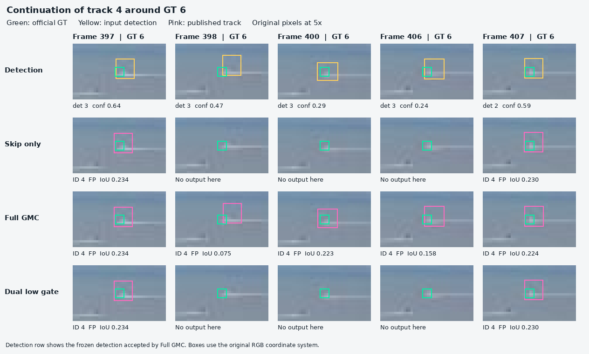
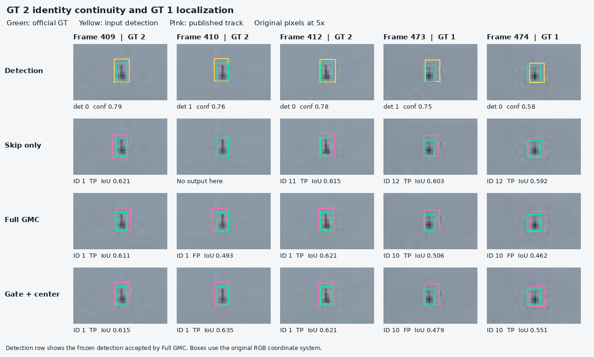

# DJI_0030_2 的 11 个净增误报与身份保持

590 帧、4,596 个官方 RGB 标注框。原始卡尔曼、RGB–T 检测、RGB ReID 和原生关联参数保持一致。逐帧调用本项目固定版本 TrackEval 的 CLEAR 分配，按同帧同一行冻结检测配对两个方法的输出，每一行对应关系都由唯一的检测分数验证。此处的换号遵循 CLEAR 的跨帧身份定义。

完整 GMC 相对仅跳过补偿有 13 个新增误报、2 个原有误报消失，净增 11 个。其中九个来自同一条轨迹的低分续接。双重确认消除了这九个误报，输出中心修正再取得一个净误报改善。两个版本均保住真值 2 的原 ID。

## 哪些帧发生了什么

| 帧 | 完整 GMC 相对仅跳过的变化 | 净增 FP |
| --- | --- | --- |
| 398–406 | 轨迹 4 多输出九个低分框，九帧均未通过真值匹配。 | +9 |
| 408 | 轨迹 4 的冻结检测行由 6 换为 4，两次输出均为 FP。 | 0 |
| 410 | 轨迹 1 输出了原先缺失的检测。原始检测与真值 2 的 IoU 为 0.642，滤波输出为 0.493。 | +1 |
| 474 | 真值 1 的同一检测从 TP 变为 FP。真值 2 附近另有一次 FP 检测行替换（1 换为 3）。 | +1 |

按检测行统计，12 项由无输出变为 FP，1 项由 TP 变为 FP，2 项由 FP 变为无输出。这些净变化分布在 11 帧。第 411 帧的 FN 减少 1 个，第 413 和 474 帧各增加 1 个，合计 FN 增加 1。

第 398 帧的检测置信度为 0.469，进入原生低分第二阶段。同一状态下备用变换与该检测的预测 IoU 为 0.378，LightGlue 变换使其升到 0.878，跨过 0.5 门限。已有轨迹从而持续接上第 399–406 帧的低分检测。第 398 帧独立背景点的中位残差从 1.624 降到 1.096 像素，背景对齐改善与这个局部跟踪框能否命中真值是两个不同的测量。

这九帧的真值 6 框均为 4×4 像素，冻结检测宽 8.0–9.0、高 8.0–9.1 像素。按面积计算，即使两框完全对齐，原始检测的 IoU 上限也只有 0.211–0.227。按官方真值，轨迹 4 在仅跳过组的 363 次输出、完整组的 372 次输出全部为 FP。它长期位于已标注目标附近，图像和 IoU 支持检测框尺度不符的解释。

## 少掉的换号与哪一帧有关

仅跳过组在第 412 帧有两次换号。真值 1 从 ID 2 换到 12，真值 2 从 ID 1 换到 11。完整组保住真值 2 的 ID 1，真值 1 仍换号一次。两组通过真值身份和冻结检测行对齐。

对两组不同的十个变换逐一做两种反事实，共 20 次。每次只替换一帧的变换，然后从头实际重跑完整跟踪序列。下表列出能区分误报与换号来源的对照，完整明细在 counterfactual/metrics_rows.csv。

| 单帧干预 | FP | FN | IDSW | 真值 2 换号帧 | 真值 1 换号帧 |
| --- | --- | --- | --- | --- | --- |
| 完整组仅撤回 398 | 1168 | 3054 | 1 | 无 | 412 |
| 仅跳过组只在 398 启用 | 1175 | 3054 | 2 | 412 | 412 |
| 完整组仅撤回 408 | 1177 | 3054 | 2 | 无 | 412,436 |
| 完整组仅撤回 409 | 1176 | 3055 | 2 | 412 | 412 |
| 仅跳过组只在 409 启用 | 1167 | 3054 | 2 | 无 | 412,435 |
| 完整组仅撤回 474 | 1175 | 3052 | 1 | 无 | 412 |

撤回第 398 帧就少了 9 个 FP，仍然只换号一次。撤回第 409 帧则使真值 2 在 412 帧重新换号。仅在 409 帧启用 LightGlue 虽然保住真值 2，真值 1 后来在 435 帧又换了一次。

## 可在线使用的修正

低分匹配双重确认仅用于完整 GMC 选择 LightGlue 的帧。原生第二阶段的低分检测继续一条活动轨迹时，从同一补偿前状态计算 LightGlue 与备用变换的两个预测框，二者都要达到原生 IoU 门限 0.5。备用变换沿用仅跳过组的规则，从原生光流与恒等变换中选取。高分关联和卡尔曼状态更新沿用原实现。

第二版在此基础上处理边界定位。选用 LightGlue 的当前帧及紧接的一帧，对已接受且置信度超过原生高分门限的观测，发布检测框中心和原滤波框宽高。关联、输出 ID、轨迹状态和后续滤波继续使用第一版的结果。两条规则只读取截至当前帧的图像和检测。

| 序列上的方案 | HOTA | IDF1 | MOTA | FP | FN | IDSW |
| --- | --- | --- | --- | --- | --- | --- |
| 仅跳过补偿 | 27.0974 | 32.9637 | 8.1593 | 1,166 | 3,053 | 2 |
| 完整自适应 GMC | 29.7521 | 37.3206 | 7.9199 | 1,177 | 3,054 | 1 |
| 低分匹配双重确认 | 29.7418 | 37.3665 | 8.1158 | 1,168 | 3,054 | 1 |
| 双重确认＋高分检测中心 | 29.7514 | 37.3939 | 8.1593 | 1,167 | 3,053 | 1 |
| 仅提高重估采用门限 | 31.9076 | 41.6370 | 8.1375 | 1,167 | 3,053 | 2 |

单用双重确认，相对完整 GMC 只移除了第 398–406 帧的九个 FP。加入输出中心修正后，第 410 帧的真值 2 从 0.493 提高到 0.635，第 474 帧的真值 1 从 0.462 提高到 0.551，均从 FP 转为 TP。代价是第 473 帧真值 1 的输出从 0.506 降到 0.479，由 TP 变为 FP，因而净减少 10 个 FP。相对仅跳过方案剩余的 1 个净增误报来自这一帧。

另试过提高总体重估采用门限，要求相对备用方案的背景中位残差至少额外改善 1 像素。该组在 412 帧保住真值 2，但真值 1 在 435 帧再次换号，整段 IDSW 回到 2。

## 固定规则迁移到官方 30 段

下列百分比指标由 TrackEval 在 12,590 帧上联合汇总，FP、FN、IDSW 为事件计数。两种修正都在真实在线图像链路重跑。

| 方案 | HOTA | DetA | AssA | IDF1 | MOTA | FP | FN | IDSW |
| --- | --- | --- | --- | --- | --- | --- | --- | --- |
| 仅跳过补偿 | 37.8825 | 25.2027 | 58.3966 | 42.4877 | 25.7971 | 13,397 | 119,597 | 402 |
| 完整自适应 GMC | 37.9604 | 25.2033 | 58.6187 | 42.6211 | 25.7921 | 13,411 | 119,597 | 397 |
| 低分匹配双重确认 | 37.9603 | 25.2035 | 58.6180 | 42.6228 | 25.7977 | 13,401 | 119,597 | 397 |
| 双重确认＋高分检测中心 | 37.9629 | 25.2055 | 58.6193 | 42.6228 | 25.7988 | 13,400 | 119,596 | 397 |

| 相对完整 GMC | ΔHOTA | ΔDetA | ΔAssA | ΔIDF1 | ΔMOTA | ΔFP | ΔFN | ΔIDSW |
| --- | --- | --- | --- | --- | --- | --- | --- | --- |
| 低分匹配双重确认 | -0.0001 | +0.0002 | -0.0007 | +0.0017 | +0.0056 | -10 | +0 | +0 |
| 双重确认＋高分检测中心 | +0.0026 | +0.0022 | +0.0006 | +0.0017 | +0.0067 | -11 | -1 | +0 |

剔除 DJI_0030_2 后，其余 29 段相对完整 GMC 的误报、漏检和换号净变化如下。事件计数按序列相加。

| 其余 29 段 | ΔFP | ΔFN | ΔIDSW |
| --- | --- | --- | --- |
| 低分匹配双重确认 | -1 | +0 | +0 |
| 双重确认＋高分检测中心 | -1 | +0 | +0 |

全量上，双重确认加中心修正相对完整 GMC 少 11 个 FP、1 个 FN，IDSW 保持 397。HOTA 增加约 0.0026 个百分点。其余 29 段合计少 1 个 FP，FN 及 IDSW 的净变化为零。其中 DJI_0028_3 少 1 个 FP 和 1 个 FN，DJI_0181_3 各多 1 个，DJI_0303_2 少 1 个 FP。单用双重确认时，目标序列以外只有 DJI_0303_2 的 FP 减少 1 个，其他序列三项事件计数持平。

逐行核验双重确认与叠加输出中心修正的 73,576 条输出，二者的发布帧、ID、检测分数与框尺寸一致。共有 391 条高分输出位于中心修正窗口，实际坐标有变化的为 391 条。

## 复现与数据口径

规则是在检查 DJI_0030_2 的官方真值后设计，该序列是针对性诊断样本。完整 30 段包含该序列，而且历史上用于选模和开发调参。30 段结果用于检查同一测试集上的取舍。

官方真值和冻结检测由本地数据提供。真值 SHA-256 见同目录 MANIFEST.json。diagnosis/frames.csv 含 590 帧各自的正确匹配、误报、漏检与换号数，detection_pairs.csv 含检测行、轨迹、真值、框与 IoU，changed_fp.csv 含 15 个发生变化的检测行。focus/audit 含修正前后相同口径的事件核对。trace/trace 含低分关联代价与实际检测索引，counterfactual/metrics_rows.csv 含 20 组单帧干预，full/compared.csv 含全量逐序列结果。

在同一服务器目录与 redetr 环境下，依次运行 python run_stage.py inspect、trace、counterfactual、focus、full、package（每次传一个阶段名）。上一轮冻结检测、ReID、变换和上游代码位置见 common_audit.py。两组历史轨迹在目标序列的冻结变换重放、实时重放和历史文件中逐字节一致。
