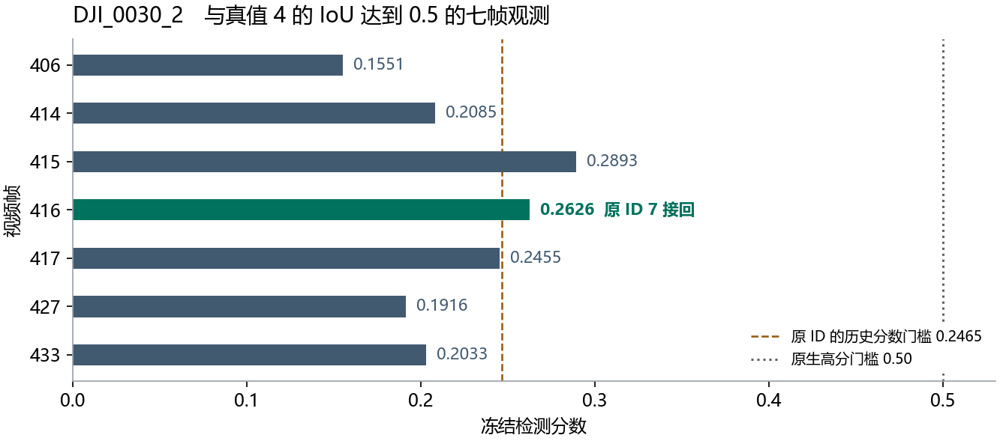

# VT-Tiny-MOT 长间隔恢复时暂存原 ID 的对照实验

**DJI_0030_2 的真值 4 在第 416 帧以原 ID 7 接回，原先压下的 67 个误报保住了。** 完整 30 段相对当前修正版少 13 个漏检、少 1 次换号、多 6 个误报。HOTA 提高 0.00431 个百分点，MOTA 提高 0.00445 个百分点，IDF1 降低 0.00015 个百分点。27 段输出文件逐字节相同。该方案适合作为保留原 ID 的消融结果，当前证据支持继续用 `evidence_both` 作为主线。

## 完整官方测试集

共 30 个序列、12,590 帧，所有类别合并。HOTA、IDF1、MOTA 为 TrackEval `COMBINED_SEQ` 汇总值，按 0–100 尺度表示。差值用未舍入值计算。所有方法共用检测和 RGB ReID 缓存。

| 方法 | HOTA ↑ | DetA ↑ | AssA ↑ | IDF1 ↑ | MOTA ↑ | FP ↓ | FN ↓ | IDSW ↓ |
|---|---:|---:|---:|---:|---:|---:|---:|---:|
| 当前长间隔修正版 `evidence_both` | 38.85964 | 26.07331 | 59.43302 | 44.08279 | 25.72203 | 15,945 | 117,234 | 352 |
| 严格确认 `pending_strict` | 38.85966 | 26.07356 | 59.43262 | 44.08262 | 25.72258 | 15,945 | 117,233 | 352 |
| 放开连续低分确认 `pending_temporal` | 38.86161 | 26.07312 | 59.43983 | 44.07391 | 25.69421 | 15,996 | 117,233 | 352 |
| **受保护暂存 `pending_guarded`** | **38.86396** | **26.07619** | **59.43947** | **44.08264** | **25.72648** | **15,951** | **117,221** | **351** |
| 受保护暂存相对当前修正版 | +0.00431 | +0.00287 | +0.00645 | −0.00015 | +0.00445 | +6 | −13 | −1 |

三个暂存方案在全量各触发 8 次暂缓。严格确认只接回 1 次，放开连续低分确认接回 2 次，受保护暂存接回 5 次。受保护版有 3 次在确认当帧正确找回了同一真值，而当前修正版在这 3 帧均漏掉该目标。另 2 次接回当帧均为 FP。以下按整段最终输出计数，包含恢复后对后续关联的影响。

| 受保护版有变化的序列 | ΔFP | ΔFN | ΔIDSW | 对照官方真值的接回去向 |
|---|---:|---:|---:|---|
| DJI_0030_2 | 0 | −1 | 0 | 第 416 帧，ID 7 接回真值 4。其余 2,837 行输出的身份与框坐标均和当前修正版相同。 |
| DJI_0169_3 | +8 | −3 | +1 | 第 114 帧，接回 ID 7，分数 0.5833 且有外观支持，但输出框与真值 6 的 IoU 仅 0.2646。同帧 ID 6 已正确跟踪真值 6。第 207 帧，接回 ID 6，外观距离 0.5223 达标，但输出框与真值 6 的 IoU 仅 0.4843。这两次当帧均计为 FP。 |
| DJI_0221_2 | −2 | −9 | −2 | 第 282、317 帧都由 ID 4 找回真值 1，两个确认当帧在当前修正版均为漏检。包含接回当帧的随后 10 帧内，原 ID 分别正确命中 1 帧、4 帧。 |
| 其余 27 段 | 0 | 0 | 0 | 所有 MOT 轨迹文件逐字节一致。 |

两次接回当帧的误报均发生在 `DJI_0169_3`，两次都跨过了观测缺口。第 114 帧即使检测分数和外观同时达标，仍把第二条轨迹接到了已有人跟踪的目标附近。包含确认当帧的随后 10 帧内，接回的 ID 7 产生 7 个 FP，正确命中原真值 0 次。第 207 帧的 ID 6 在相应 10 帧内有 4 次 FP、2 次正确命中。窗口计数描述每条轨迹自身，整段净变化还包括其他轨迹分配的改变。

本轮规则根据 DJI_0030_2 的官方测试标注诊断后冻结，再评测全部 30 段。去掉该段后，其余 29 段合计 ΔFP +6、ΔFN −12、ΔIDSW −1。全量结果反映当前测试集上的取舍。实际改变只涉及 3 个序列，受保护版同时改变了等待时限、跨缺口确认和接回后的低分保护，现有对照不能分配这三项的独立收益。

[30 段总体指标与接回计数](30段_总体指标与接回去向.csv) · [逐序列绝对值和差值](30段_逐序列对照.csv) · [五次接回及后十帧核验](full/guarded_release_context.csv)

## DJI_0030_2 的真值 4

受保护的暂存版在第 416 帧以原 ID 7 正确接回真值 4。相对当前长间隔修正版 `evidence_both`，整段 590 帧只新增这一个正确输出。逐检测行核对后，新增误报和消失误报均为 0，上一轮压下的 67 个误报全部保持消除。第 417 帧退出后，ID 7 未再命中真值 4。

| 在 DJI_0030_2 上运行的方案 | TP | FP | FN | IDSW | 第 391 帧以后用 ID 7 命中真值 4 | 原 67 个误报重新出现 |
|---|---:|---:|---:|---:|---|---:|
| 当前长间隔修正版 | 1,557 | 1,280 | 3,039 | 0 | 0 帧 | 0 |
| 严格确认，只接受高分或可靠 RGB 外观 | 1,557 | 1,280 | 3,039 | 0 | 0 帧 | 0 |
| 放开连续低分确认 | 1,557 | 1,331 | 3,039 | 0 | 0 帧 | 51 |
| 受保护暂存，只记录候选与拟接回事件 | 1,557 | 1,280 | 3,039 | 0 | 0 帧 | 0 |
| **受保护暂存，实际接回** | **1,558** | **1,280** | **3,038** | **0** | **第 416 帧** | **0** |

第 371 帧是当前修正版最后一次把 ID 7 正确分配给真值 4。ID 7 的最后一次轨迹更新发生在第 391 帧，该帧输出本身记为误报。真值 4 的有效标注持续至第 514 帧。从第 392 到 514 帧的 123 个标注帧中，只有 7 帧有分数大于 0.1 且与真值 4 的 IoU 达到 0.5 的冻结检测，七帧的分数均低于 0.5。这个计数衡量原始检测支持，最终 TP 由 TrackEval 根据跟踪输出框和同帧其他目标共同分配。

| 帧 | 送入跟踪器的观测与实际决策 |
|---|---|
| 404 | ID 7 距最后一次更新已过 13 帧。B 的重连代价为 0.5308，但支持它的都是低分框，缺少可靠外观。保留 ID 7、旧轨迹的状态与外观快照，以及最近五次输出的检测分数中位数 0.24653。 |
| 405–409 | 在 405、406、408、409 帧得到私有候选匹配。即使 406 帧的原始检测与真值 IoU 达到 0.5020，也没有足够证据输出 ID 7。 |
| 414–416 | 新出现的候选连续三帧分数为 0.2085、0.2893、0.2626，相邻帧经 GMC 对齐后通过几何一致性检查。第 416 帧，跨缺口关联代价为 0.5456，低于 0.55 的保守上限。此时距暂存 12 帧、距最后一次更新 25 帧。当帧接回的输出框与真值 4 的 IoU 为 0.5505，官方分配为 TP。 |
| 417 | 原始检测与真值 4 的 IoU 为 0.5135。该检测的分数为 0.24547，比原轨迹门槛 0.24653 低约 0.00106。保护规则在低分匹配阶段拒绝该框，连续跟踪在这里中止。 |
| 427、433 | 两个原始检测仍覆盖真值 4，分数为 0.1916、0.2033。受保护版均未输出 ID 7。 |
| 446 | 放开连续低分确认的对照在此帧接回了背景轨迹 ID 4，当帧计为 FP，整段重新引入 51 个历史误报。受保护版将 ID 4 的候选从第 428 帧保留到第 459 帧到期，全程未提升为正式轨迹。 |



[逐帧真值与原 ID、检测分数和 IoU](DJI_0030_2_GT4_检测与原ID逐帧核验.csv) · [原 67 个误报逐项复核](DJI_0030_2_历史67个误报逐项复核.csv) · [逐检测行的官方分配与框坐标](focus2/focus_diffs/pending_guarded/detection_pairs.csv) · [候选事件](focus2/focus_events.json)

## 暂存和接回规则

当前修正版保留 `B_early_moderate`、自适应 GMC、低分匹配双重确认和原版卡尔曼滤波。长间隔且受 GMC 改动影响的重连需要额外观测证据。本实验在这一步被暂缓后继续保留有唯一候选的原身份。正式轨迹或 B 的正常恢复已占用的观测有优先权。

- **严格确认 `pending_strict`。** 保存旧身份和私有位置，等待高分观测或可靠 RGB 外观。原实现连续缺少候选超过 6 帧时结束暂存。DJI_0030_2 的 ID 7 因此在第 416 帧、当帧观测处理前到期。
- **连续低分对照 `pending_temporal`。** 在严格版基础上，也接受三帧连续、GMC 对齐后 IoU 均达 0.5、末帧分数及三帧中位数均达到旧轨迹分数门槛的观测。这一版允许仅凭近几帧低分框的一致性确认原身份。
- **受保护暂存 `pending_guarded`。** 候选自暂存起最多等待 30 帧。连续低分接回时，还要求原身份在暂存时的关联代价不超过 0.55，并排除竞争身份。跨越缺观测的空档时需要一段新形成的连续轨迹，位置搜索范围随间隔放宽，上限 48 像素。确认前仅推进私有位置，正式状态和外观库维持原流程。确认时以当前检测重启原 ID。弱证据接回后，原生低分关联和 B 的再次恢复继续检查原轨迹的分数门槛，直至得到高分观测。三组均在线逐帧运行，回填帧数为 0。
- **只记录候选 `pending_shadow`。** 专项对照只在 DJI_0030_2 运行，记录拟接回事件。轨迹文件与当前修正版逐字节一致，SHA-256 为 `d1749709af5d44c8c90eab2d2fb897274add25288830874d152acda3602dddf0`。

高分定义为检测分数大于 0.5。可靠外观要求已缓存的 RGB 特征通过距离门槛。本例第 416 帧没有可用的外观距离，接回来自时间、几何和旧身份的联合约束。跟踪代码使用观测和实际分配记录，官方真值只进入离线核验。

## 复现与核验

在复现布局的 `b_gmc_pending_id_r1` 下，新轨迹位于 `runs/full/<方案>/trackers/<方案>/data`。当前参考的 30 段轨迹从相邻的 `b_gmc_forensics_r1/full_runs/evidence_both` 读取。两轮专项与全量评分分别保存在 `results/focus`、`results/focus2` 和 `results/full`。

使用 `redetr` 环境，从服务器实验目录运行以下命令。现有目录将核验并复用已完成的轨迹。要从头重跟踪，可将本目录中的 Python 脚本与 `plan_*.json` 复制到同级新目录后执行，父目录下使用同一套历史实验、工具和缓存。

```bash
python -Bu driver.py focus
python -Bu driver.py focus2
python -Bu driver.py full
python -Bu -c "from driver import ROOT,run; run([ROOT/'release_context.py'])"
python -Bu verify_tables.py
```

检测权重 SHA-256 为 `59ecddb827adb8b6ed75d78b644cc09e8fcdc9c83870cd1f8a9446ad679dc3ec`，RGB ReID 权重 SHA-256 为 `27f110f2fa8ae3c619941c126699486771a42d252b4e675d1c077bb91e0bd2d1`。逐序列核对了检测、外观特征、解码图像和轨迹文件的哈希。三组新方法在完整评测里对 DJI_0030_2 的输出都和各自专项运行逐字节一致。逐帧 TP、FP、FN、换号使用同一套 TrackEval CLEAR 匹配，按预测框与官方真值 IoU 达到 0.5 计分。

[完整评分与运行协议](full/metrics/evaluation_audit.json) · [专项与全量输出校验](full/parity.json) · [每段暂存与接回次数](full/pending_by_sequence.csv) · [接回实现](../../../../../../../experiments/vttiny_gmc/b_gmc_recovery/pending/pending_refined.py)
